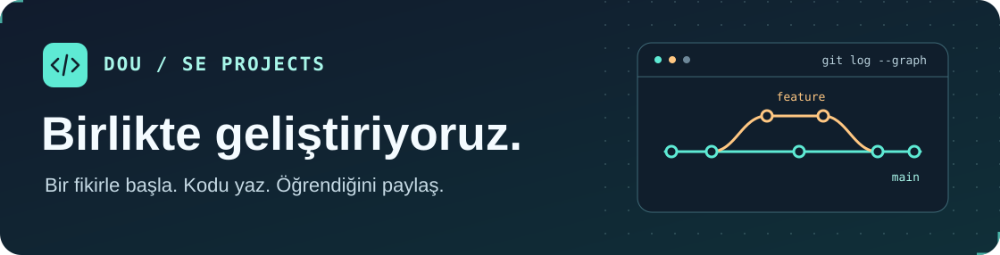

  

<h1 align="center">Doğuş Üniversitesi Yazılım Mühendisliği Projeleri</h1>

  Ders projeleri geliştiriyor, kodu birlikte inceliyor ve öğrendiklerimizi paylaşıyoruz.

  <a href="https://github.com/orgs/DOU-SEProjects/discussions"><strong>💬 Sohbete katıl</strong></a>
  · <a href="https://github.com/orgs/DOU-SEProjects/repositories">📂 Projeleri keşfet</a>
  · <a href="https://github.com/orgs/DOU-SEProjects/discussions/categories/announcements">📣 Duyuruları takip et</a>

## 💬 Topluluk sohbeti

Yeniysen **Genel Sohbet**’te kendini tanıtabilirsin. Üzerinde çalıştığın bir proje ya da öğrenmek istediğin bir konu varsa onu da paylaş.

| Başlık | Burada ne paylaşabilirsin? |
| :--- | :--- |
| [Genel Sohbet](https://github.com/orgs/DOU-SEProjects/discussions/categories/general) | Tanışma, kaynak önerileri ve ekip sohbeti. |
| [Soru–Cevap](https://github.com/orgs/DOU-SEProjects/discussions/categories/q-a) | Takıldığın bir konu, denediğin yöntem ve varsa aldığın hata. |
| [Proje Fikirleri](https://github.com/orgs/DOU-SEProjects/discussions/categories/ideas) | Çözmek istediğin bir problem veya birlikte geliştirmek istediğin bir fikir. |
| [Proje Vitrini](https://github.com/orgs/DOU-SEProjects/discussions/categories/show-and-tell) | Demolar, ekran görüntüleri ve projenden öğrendiklerin. |

## 🛠️ Bir projeye katkı ver

1. [Depoları](https://github.com/orgs/DOU-SEProjects/repositories) incele ve ilgini çeken projenin README’sinden başla. Bazı depolar yalnızca erişimi olan üyelere görünür.
2. Belirli bir projede hata veya geliştirme önerisi varsa o deponun **Issues** bölümüne yaz. Birden fazla ekibi ilgilendiren fikirleri [Discussions](https://github.com/orgs/DOU-SEProjects/discussions)’ta konuşalım.
3. Bir değişiklik hazırladığında **Pull Request** aç ve neyi değiştirdiğini, nasıl denediğini kısaca anlat. Belge düzeltmeleri ve testler de katkıdır.
